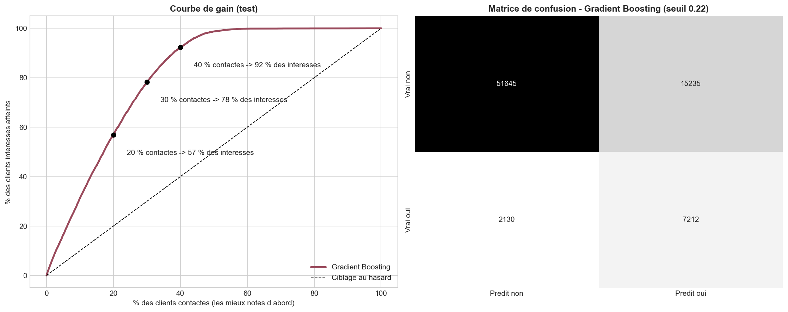
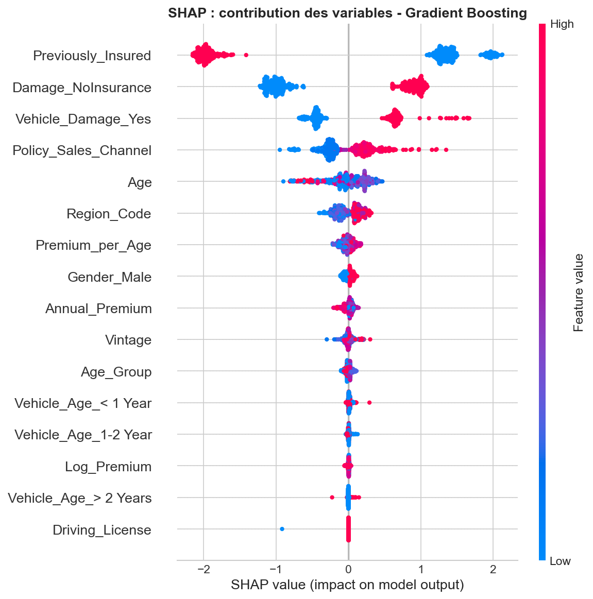

# Vente croisée : assurance santé → assurance automobile

Parmi 381 109 clients d'une assurance santé, lesquels seraient intéressés par une assurance automobile ? L'objectif est de cibler les campagnes commerciales. Seuls 12,3 % des clients sont intéressés.

Données : [Kaggle - Health Insurance Cross Sell Prediction](https://www.kaggle.com/datasets/anmolkumar/health-insurance-cross-sell-prediction), version avec valeurs manquantes. Placer `train.csv` à côté du notebook.

## Résultats (jeu de test de 76 222 clients, jamais utilisé pour un choix)

| Modèle | AUC | Rappel | Précision |
|---|---|---|---|
| Régression logistique | 0,843 | 0,80 | 0,31 |
| Arbre de décision | 0,849 | 0,77 | 0,32 |
| Forêt aléatoire | 0,852 | 0,78 | 0,32 |
| **Gradient Boosting** | **0,854** | 0,77 | 0,32 |

**Usage métier** : en contactant les 30 % de clients les mieux notés, on atteint **78 % des intéressés**.



## Méthode

- **Pas de fuite d'information.** On sépare d'abord le jeu de test. L'imputation, l'encodage, le rééquilibrage, la sélection de variables, les hyperparamètres et le seuil de décision sont tous appris sur le train, à l'intérieur de pipelines.
- **Rééquilibrage.** SMOTE, SMOTENC, ADASYN, sous-échantillonnage et pondération des classes sont chacun réglés, puis comparés par validation croisée. Une fois réglés, ils donnent tous la même AUC à 0,0005 près.
- **Sélection de variables adaptée à chaque modèle :**
  - stepwise pour la régression logistique ;
  - RFECV pour l'arbre et la forêt ;
  - importance par permutation pour le Gradient Boosting.

  Elle n'est gardée que si elle fait au moins aussi bien que l'ensemble des variables.
- **Réglage de chaque modèle** par recherche aléatoire d'hyperparamètres. L'arbre de décision passe ainsi d'une AUC de 0,60 à 0,85.
- **Seuil de décision** choisi sur des prédictions hors échantillon du train. Au seuil par défaut de 0,5, plusieurs modèles ne détectaient presque aucun client intéressé.
- **Interprétation** par importance par permutation, SHAP, LIME et contrefactuels. Le canal de vente est le seul levier sur lequel l'entreprise peut agir.
- **Reproductibilité** : une graine unique (`SEED = 42`) pour toutes les étapes.



## Lancer le notebook

```bash
pip install -r requirements.txt
jupyter nbconvert --to notebook --execute --inplace vente_croisee_assurance.ipynb
```

Technologies : Python, pandas, scikit-learn, imbalanced-learn, SHAP, LIME.
